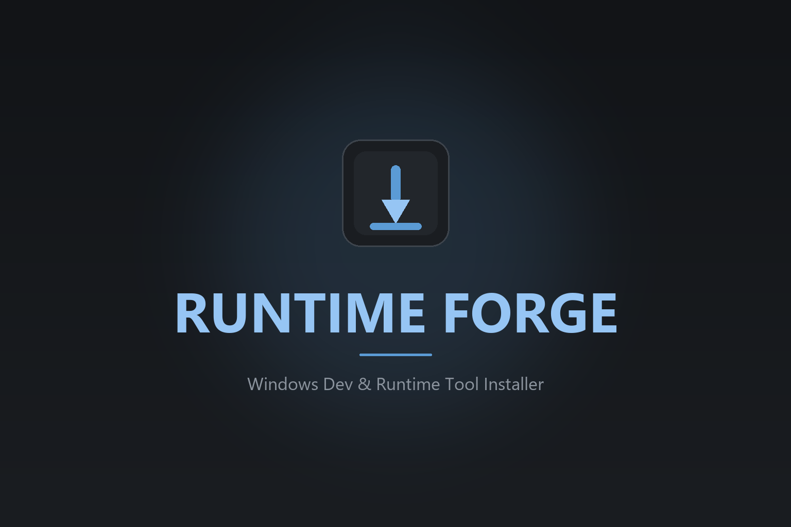
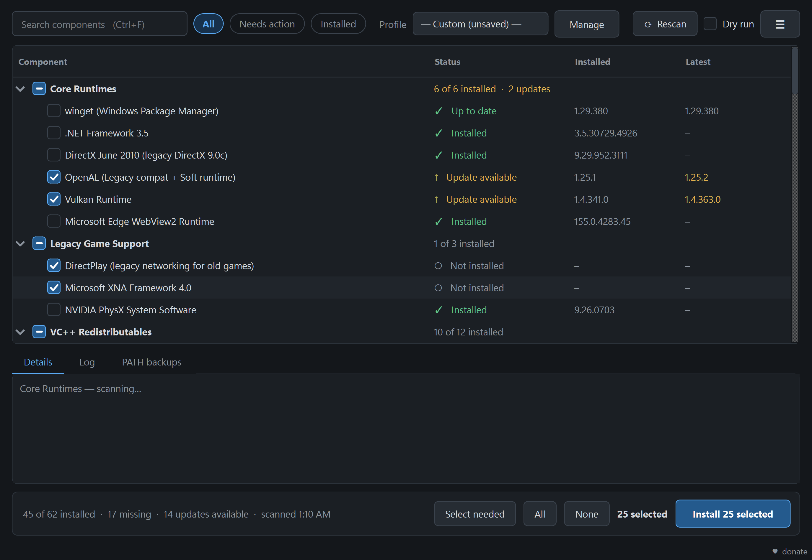

<p align="center"></p>

Runtime Forge
======================

<p align="center">


</p>

**One window to see, pick and install everything a fresh Windows 11 machine
(or a machine full of old games) is going to ask for.** Runtime Forge scans
what's already installed, shows each component's installed and latest version
side by side, and installs, updates or removes exactly the ones you tick —
the legacy runtimes old games and installers demand (DirectX 9.0c, VC++ 2005
and up, .NET Framework 3.5, OpenAL), the modern runtimes apps need (.NET 8–10,
VC++ 2015–2022, WebView2, Vulkan), and the developer toolchain (Python, JDKs,
Git, Node, CMake, LLVM, VS Code...). Every download is checked against its
publisher's signature and/or a SHA-256 before it runs, and nothing is
installed until you've confirmed.

Author: XechostormX

Screenshot
----------
<p align="center"></p>

What it does
------------
- **See what's already installed** before doing anything — every component
  is scanned on launch and shows its installed version (and, where a newer
  release exists, what's available) instead of a plain yes/no. All 62
  components report their real installed version, not just presence; 37 of
  them can also be checked for updates against a real source (a live API, or
  this app's own pinned install target). The other 25 — DirectX, .NET
  Framework 3.5, WebView2, DirectPlay, XNA, the VC++ redistributables, the
  self-updating apps and the Windows Terminal profile — have no meaningful
  "latest version" to compare against at all
  (DirectX's June 2010 redistributable is genuinely the final one Microsoft
  ever shipped, WebView2 self-updates in the background regardless of this
  app, the VC++ installers are evergreen URLs rather than versioned
  releases, and so on).
- **Pick exactly what you want** — every VC++ redist year/arch, every .NET
  runtime piece, every JDK, every Python version, and every dev tool is its
  own checkbox, not an all-or-nothing run.
- **Dry Run** toggle previews every download/install without touching the
  system — the whole install runs, minus the download and the install.
- **Real update handling, not just detection** — checking an "update
  available" row and clicking Install actually upgrades it (PowerShell 7,
  Git, Node, CMake and the JDKs all upgrade in place via their own
  installers); it doesn't just skip because something's already present.
- **PATH verification** — every install already requests PATH be updated
  (`ADD_PATH=1`, `PrependPath=1`, etc), but a flag can still silently fail
  to apply — silent installers are famous for it. After install, the tool checks
  whether the install directory is actually on PATH and flags it distinctly
  if not, instead of only confirming the software itself is present.
- **PATH backups** — one automatic snapshot of the machine + user PATH per
  real install run (not per component), plus one baseline snapshot taken
  automatically the very first time the app is ever launched, before it's
  touched anything. The **PATH backups** tab's "Back up now" covers
  everything in between. All restorable from a dropdown with a before/after preview —
  restoring itself takes a fresh backup first, so it's never a one-way door
  either.
- **A "Basic" profile ships seeded on first run** — broad compatibility
  coverage (Core Runtimes, all VC++ Redistributables, all .NET Runtimes),
  plus one default Python (3.13 — 3.10 reaches end-of-life in October 2026)
  and one default JDK (17 — the longer-established LTS), since most people
  just want *a* runtime of each rather than picking a version. Every
  version still stays individually selectable in the tree regardless.
  Deliberately not opinionated about the rest of dev tooling (Git/Node/
  CMake/VS Code/PowerShell). Only seeds if you have zero profiles at all —
  never overwrites or fights with anything you've built or renamed.
- **Fast scans** — every component's presence check and latest-version lookup
  runs concurrently (8 at a time); lookups share one in-process cache (the
  nine .NET components share a single request, and installing reuses what
  the scan already resolved), the registry's Uninstall keys are read once per
  scan instead of once per component, and GitHub's rate limit is handled
  (`GITHUB_TOKEN`, see below). Installs themselves stay strictly sequential —
  several installers here share Windows Installer's single global lock, so
  parallelizing *those* would risk real install failures for a small time win.
- Fully Python install engine — no PowerShell dependency at runtime, aside
  from the winget `.msixbundle` install step (Windows has no other ergonomic
  API for it). Authenticode signatures are verified through `WinVerifyTrust`
  directly. Everything else runs `msiexec.exe`, `dism.exe`, or the vendor's
  own downloaded installer via `subprocess`.
- Requests admin elevation automatically via the packaged .exe's embedded
  manifest — no separate elevation batch file. (Run from source without
  elevation and the window works for scanning, Dry Run, profiles and PATH
  backups, with a banner offering a one-click relaunch as administrator.)

Using the app
-------------
- **Tree:** Status / Installed / Latest per component; category rows summarize
  themselves ("5 of 6 installed · 1 update"). Double-click a row to check it.
- **Search and filter:** the box (Ctrl+F) matches component names; **All / Needs
  action / Installed** narrows the list. "All" in the bottom bar checks only
  what's currently visible.
- **Select needed** checks everything missing or outdated. The **Install**
  button always says what it will do ("Install 5 selected", or "Dry run 5
  selected" when Dry run is on); the confirm dialog lists the components.
- **Right-click a row** for Install / Update to X / Reinstall, Open install
  location, Copy version, Copy download URL, Uninstall.
- **Bottom pane:** *Details* (versions, download URL, SHA-256, install
  location, whether it can be uninstalled), *Log* (colour-coded; Copy /
  Clear / Open log file), *PATH backups*. Drag the divider to resize or
  collapse it.
- **Profiles:** pick one from the dropdown, **Manage** to save / update /
  delete / import / export — or drop a profile `.json` anywhere on the window.
- **Theme:** ☰ menu → Theme → Follow Windows (default), Dark or Light.
- **Updates:** the packaged app makes one quiet request to GitHub at launch
  and shows "v0.x available" in the status bar when a newer release exists
  (☰ → "Check for app updates" turns it off).
- Shortcuts: Ctrl+F search, Ctrl+R rescan.

Running from source
--------------------
```
python -m venv venv
venv\Scripts\python.exe -m pip install -r requirements.txt
venv\Scripts\python.exe runtime_forge.py
```
(Always go through `python.exe -m ...` rather than the `pip.exe` /
`pyinstaller.exe` launchers in `venv\Scripts` — those embed the venv's
original path and silently misbehave if the folder was ever moved.)
Real installs need admin rights (most write to `HKLM`, `Program Files`, or
`System32`) — launch an elevated terminal first, or build the exe (below),
which prompts for elevation on its own. Running un-elevated is fine for
scanning and Dry Run.

Building the .exe
------------------
```
venv\Scripts\python.exe -m pip install -r requirements-dev.txt
venv\Scripts\python.exe -m PyInstaller RuntimeForge.spec --clean
```
(`RF_NO_ADMIN=1` builds a copy that doesn't demand elevation, handy for
trying UI changes; release builds leave it unset.)
Output lands in `dist\RuntimeForge\` — copy the whole folder to
distribute. Running that folder directly is portable: settings
(`RuntimeForge.ini`), logs, profiles and PATH backups are written next to the
exe, and nothing touches the registry except the components you choose to
install. (The installed copy stores those in `%LOCALAPPDATA%\RuntimeForge`
instead, unless a file named `portable.txt` sits next to the exe.)

Building the Windows installer
-------------------------------
The `dist\RuntimeForge\` folder above is portable but has no Start
Menu entry and no uninstaller. `installer\RuntimeForge.iss` (an
[Inno Setup](https://jrsoftware.org/isinfo.php) script) wraps it into a real
installer — Program Files install, Start Menu shortcut, uninstaller. Build
the `dist\` folder first (above), then:
```
"<path to>\ISCC.exe" installer\RuntimeForge.iss
```
Output lands in `dist_installer\RuntimeForge-Setup-<version>.exe`
(gitignored — the `.iss` script is what's tracked, not the built installer
binary). The installer requires admin rights, same as the app itself
already does on every launch via its embedded manifest — this is a
Start-Menu, run-occasionally desktop app, so deliberately no desktop icon
task, no auto-start entry, and no tray icon/background service.

Dev tools
---------
Everything lives in `tools/`; run any of them with
`venv\Scripts\python.exe tools\<name>.py`.

| Tool | What it's for |
|---|---|
| `run_tests.py [filter...] [-v]` | Runs every `tests/test_*.py` in its own process (offscreen Qt, throw-away data dir) and prints one PASS/FAIL line each. |
| `verify_downloads.py [--only k,k] [--skip k,k]` | Downloads every component through the real hash/signature checks without installing anything. Run it after touching a URL, hash or publisher. ~1.5 GB for everything. |
| `screenshot.py [out.png] [--width N --height N] [--no-banner]` | Renders the real window after a real scan to a PNG (how `assets/screenshot.png` is made). |
| `inspect_dll_version.py <path> [field ...]` | Prints a DLL/EXE's PE VERSIONINFO fields — what caught the OpenAL false-positive (an NVIDIA-bundled `OpenAL32.dll` passing a filename-only check). Reach for it when two binaries share a filename but not an identity. |
| `gen_icon.py`, `gen_banner.py`, `gen_check.py` | Regenerate `assets/icon.*`, `assets/banner.png`, and the tick / dash / chevron images the stylesheet uses. Need Pillow (`requirements-dev.txt`). |

**Tests** (`tests/`) are one script per fix or feature, each driving a real
`MainWindow` (or the component registry) directly rather than mocking
everything. Not a pytest suite: each prints `name: True/False` lines and
`ALL_OK: True/False` and exits accordingly, so any one runs on its own
(`venv\Scripts\python.exe tests\test_ui_redesign.py`) and `tools\run_tests.py`
runs them all.

**Environment variables**

| Variable | Effect |
|---|---|
| `GITHUB_TOKEN` / `GH_TOKEN` | Lifts GitHub's 60-requests-an-hour limit for version lookups. Only ever sent to `api.github.com`. |
| `RUNTIME_FORGE_DATA_DIR` | Redirects logs, `RuntimeForge.ini`, profiles and PATH backups (tests use it so they never touch real data). |
| `RF_NO_ADMIN=1` | At *build* time: the exe won't demand elevation. |
| `RF_FORCE_UPDATE_CHECK=1` | Makes a source checkout do the "newer release?" check the packaged app does. |

What It Installs / Enables
-----------------------------------------------
Everything the tree offers, by category (62 components in all):

**Core Runtimes** — winget, .NET Framework 3.5, DirectX June 2010 (full
legacy DirectX 9.0c via DXSETUP), OpenAL (plants the Legacy compatibility
registry key old installers check for, then overwrites the actual DLL with
OpenAL Soft's modern implementation — verified by reading the DLL's own
version resource, not just its filename), Vulkan Runtime, Microsoft Edge
WebView2 Runtime.

**VC++ Redistributables** — 2005 through 2015–2022, x86 and x64 (12 rows),
the 2015–2022 pair always resolving to the latest evergreen release.

**.NET Runtimes** — Framework 4.8.1, plus .NET 8/9/10 ASP.NET Core + Desktop
Runtimes (6 and 7 are intentionally omitted — both are past end-of-support).

**.NET SDK** — 8, 9, and 10, for actually building .NET apps rather than
just running them. Same Microsoft releases-metadata API as the runtimes
above (it has a `latest-sdk` field per channel alongside `latest-runtime`).

**Java (Temurin JDK)** — 21, 17, and 8, resolved to the latest release from
Adoptium's `temurin<N>-binaries` GitHub releases (falling back to the
Adoptium API), with the release's SHA-256 verified before running it.

**Python** — 3.10, 3.11, 3.12, 3.13, 3.14 (pinned patch versions, all-users
install with PATH and the launcher). python.org only publishes Windows
installers for a series until it goes security-only, so 3.10–3.12 are pinned
to their last installer release. Also here: **uv**, the fast Python package
manager (portable — placed in `Program Files\uv` and added to PATH).

**Dev Tools** — PowerShell 7, Git for Windows, Node.js (LTS), CMake, Visual
Studio Code, GitHub CLI, LLVM/Clang, ninja, and jq — each resolved to its
latest release/LTS at scan time via GitHub/nodejs.org/Microsoft APIs, with
a pinned fallback if the API can't be reached. ninja and jq ship as a raw
binary/zip with no installer at all — this app places the binary itself
and adds its folder to PATH directly (`core/path_backup.add_directory_to_path`),
the only two components that need to (uv, below, does the same).

Also under Dev Tools: **Windows Terminal** (the verified `.msixbundle` from
its GitHub release — the bundled terminal profile below needs it), **MSYS2**,
**Inno Setup** and **Ghidra** (portable; extracted to `Program Files\Ghidra`,
and it wants a JDK 21, which is right above).

**Archive Tools** — 7-Zip and WinRAR, close to universally needed
regardless of what the machine is otherwise for. Neither publishes a live "latest version" API
(confirmed unreliable for both during research — a scraped download page
that doesn't reflect the real current release is worse than no check at
all), so both are hand-pinned like Python rather than tracked live. WinRAR
is shareware (nags for a license after the 40-day trial, never actually
expires) — installing it here doesn't change that. Also: if you were ever
going to actually pay for one piece of software in your life, on the honor
system, after decades of never enforcing its own trial — make it this one.
Ask them on Twitter for a big discount first, though.

**Legacy Game Support** — **DirectPlay** (the old networking layer, switched
on as a Windows optional feature with `dism.exe`), **Microsoft XNA Framework
4.0** (a verified MSI; a lot of indie games from that era need it) and
**NVIDIA PhysX System Software** (installed through winget).

**Go & Rust** — **Go** (the MSI, checked against the SHA-256 on go.dev's
download page and Google's signature) and **Rust** (`rustup-init`, checked
against the SHA-256 the Rust project publishes, then `rustup` fetches the
stable toolchain for the current user). Rust links with the Microsoft C++
build tools, so Visual Studio Build Tools has to be there too.

**Apps** — a small, entirely optional set: **Google Chrome** (the enterprise
MSI, signature-checked), and **Discord**, **AnyDesk** and the **Claude**
desktop app, installed through winget. Apps — and the other things marked
*optional* in the Details tab (Go, Rust, uv, Ghidra, MSYS2, Inno Setup,
PhysX) — are never pre-checked by the first scan or by *Select needed*; you
tick them deliberately. (An update to one that's already installed *is*
selected.)

**Extras** — a curated, color-coded Windows Terminal profile: one entry per
Python version (3.10 – 3.14), a Node REPL, a JShell (JDK 21) REPL, Git Bash, MSYS2 (hidden
by default, only useful if you have MSYS2), VS 2022 dev consoles, plus
elevated variants of the shells. Bundled with this app
(`assets/windows_terminal_settings.json`) rather than read from its
personal OneDrive backup location, so it's fully self-contained and works
on a fresh machine that hasn't synced that folder yet. Detected via SHA256
comparison against the live `settings.json` — not just "does a settings
file exist," but "does it match exactly what this app would install."
It refuses to run unless Windows Terminal is installed (so it never creates
an orphan settings folder), and never overwrites an existing settings.json
without backing it up first
(`settings.json.bak_<timestamp>`, right next to the real file) — this is
a personal config file, not something to silently discard.

Behavior Notes
--------------
- Every component is re-verified after install using the same presence
  check that decides whether to skip it — "Installed" in the summary only
  ever means "confirmed present," not just "the installer's exit code
  looked fine."
- Downloads retry up to 3 times with a 5-second delay and reject
  implausibly small files (usually an error page instead of the real
  installer).
- `temp_installers\` is created next to the exe during a real install and
  removed afterward (it stays beside the exe, not in your user profile,
  because the files in it are run elevated and must not be writable by
  unelevated processes); Dry Run touches nothing on disk or the network
  beyond logging what it would have done.
- Log files (`RuntimeForge_Log_*.txt`), `RuntimeForge.ini`, `profiles\` and
  `path_backups\` live in `%LOCALAPPDATA%\RuntimeForge` for an installed
  copy (next to the exe when run from source or with a `portable.txt`
  beside it). Data from an earlier release that was written next to the exe
  is moved there on first launch. Newest 10 logs retained.

Installer integrity
-------------------
Every installer is checked before it runs, and again immediately before it
is executed (so a file swapped on disk in between is caught):
- **Authenticode** (via `WinVerifyTrust`): the signature must be valid *and*
  the signer must be the expected publisher for that component (Microsoft,
  Python Software Foundation, Eclipse, Kitware, GitHub, OpenJS, LunarG,
  win.rar, ...). A valid signature from anyone else is refused.
- **SHA-256**: GitHub release assets are checked against the digest GitHub
  publishes, VS Code against its update API's hash, and the installers that
  ship unsigned (7-Zip, LLVM, jq, ninja, OpenAL Soft) against hashes pinned in
  source. A mismatch is never retried; the file is discarded.

Components installed *through winget* (Discord, AnyDesk, Claude, MSYS2, Inno
Setup, PhysX) are verified by winget itself against the SHA-256 in each
package's reviewed manifest; they need the winget component installed first,
and the app says so plainly if it isn't.

`tools\verify_downloads.py` downloads every component through this same
path without installing anything and reports which ones verify - run it
after touching a URL, hash, or publisher, or now and then to catch a vendor
re-signing or republishing. Set `GITHUB_TOKEN` (or `GH_TOKEN`) to lift
GitHub's 60-requests-an-hour unauthenticated limit; the token is only ever
sent to `api.github.com`.

Support
-------
If this is useful, a Ko-fi helps a lot: [ko-fi.com/xechostormx](https://ko-fi.com/xechostormx) ♥
